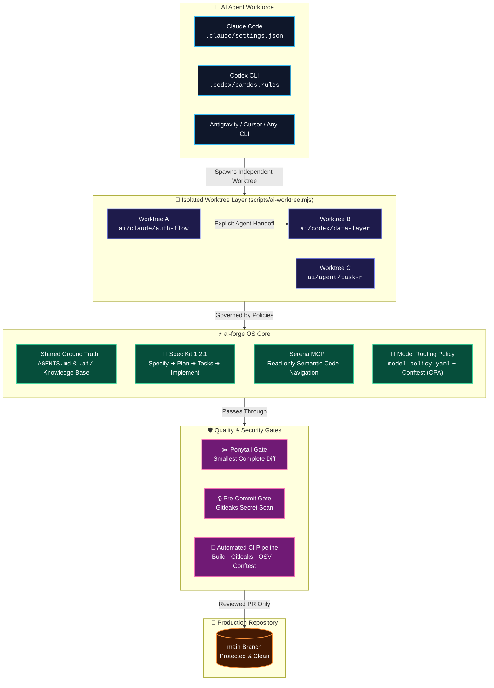
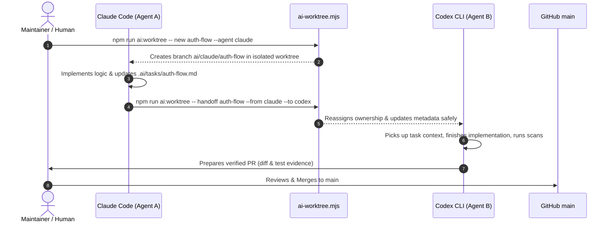

<div align="center">

# ⚡ ai-forge

### The AI-Native Engineering Operating System
**Run Claude Code, OpenAI Codex, and multi-agent AI workforces in the same repository — without drift, conflicts, or chaos.**

<br/>

[](https://github.com/iamSachinDev/ai-forge/actions)
[](LICENSE)
[](package.json)
[](AGENTS.md)
[](https://github.com/dietrichgebert/ponytail)
[](.specify/)
[](.githooks/)

<br/>

[⚡ Quick Start](#-quick-start) •
[💡 Why AI-Native?](#-why-ai-native) •
[🏗️ Architecture & Flows](#%EF%B8%8F-architecture--flows) •
[✨ What Ships Today](#-what-ships-today) •
[🛡️ Guardrails & Policy](#%EF%B8%8F-guardrails--risk-governance) •
[🗺️ Roadmap](#%EF%B8%8F-roadmap) •
[🤝 Contributing](#-contributing)

</div>

---

> [!IMPORTANT]
> **Public by design.** Everything in this repository is built to be 100% safe to publish: synthetic test fixtures, automated secret scanning at commit and CI time, and hard permission boundaries for external network and credential flows.

---

## 🧨 The Problem vs. The ai-forge Solution

When multiple AI coding agents run in a single standard repository, things break quickly: agents clobber uncommitted files, drift from project conventions, generate thousands of lines of bloated code, and leak credentials into commits. 

**ai-forge is the missing operating layer that restores order, determinism, and safety.**

| 🧨 Agent Chaos *(Without ai-forge)* | ⚡ Deterministic Engineering *(With ai-forge)* |
|:---|:---|
| 💥 **File Clobbering**: Agents edit the same working tree simultaneously, overwriting each other's work and breaking builds. | 🌿 **Git Worktree Isolation**: Every agent task gets an isolated branch and worktree directory (`ai/<agent>/<task>`). |
| 🌀 **Rule Drift**: Disjointed instruction files for Claude, Codex, and Cursor drift apart within days. | 📖 **Single Ground Truth**: A shared `AGENTS.md` and structured `.ai/` knowledge base (Hot/Warm/Cold tiers) guide every agent. |
| 🪨 **Diff Bloat**: Agents write massive wrappers, redundant utility layers, and unnecessary code no human asked for. | ✂️ **Ponytail Discipline**: Built-in minimalism gate enforcing the smallest complete diff that solves the task. |
| 🔓 **Secret Leaks**: Agents accidentally stage and commit environment variables or tokens to public repos. | 🛡️ **Multi-Tier Guardrails**: Gitleaks pre-commit hooks, sandboxed shell execution, and OPA/Conftest policy checks. |
| 🎲 **"Vibes-Based" Coding**: Agents start writing code immediately based on vague prompts without clear acceptance criteria. | 📐 **Spec-Driven Architecture**: Spec Kit 1.2.1 workflow (`specify → plan → tasks → implement → converge`) with requirement IDs. |
| 💸 **Uncontrolled Costs**: Running expensive models on trivial tasks inflates token bills. | 🧭 **Model Routing Engine**: Policy-driven model selector (`model-policy.yaml`) matching tasks to optimal models. |

---

## 🏗️ Architecture & Flows

### 1. High-Level System Architecture



---

### 2. The Spec-Driven Delivery Lifecycle

Every feature goes through a formal progression before touching production code:

```mermaid
flowchart LR
    A["💡 Feature Brief"] --> B["📐 /speckit-specify<br/>Requirements &amp; User Stories"]
    B --> C["📋 /speckit-plan<br/>Architecture &amp; Strategy"]
    C --> D["✅ /speckit-tasks<br/>Dependency Ordered"]
    D --> E["🌿 Worktree Created<br/><code>ai-worktree new &lt;task&gt;</code>"]
    E --> F["💻 /speckit-implement<br/>Autonomous Agent Coding"]
    F --> G{"✂️ Ponytail Gate<br/>Smallest Diff?"}
    G -- "Bloated Diff" --> F
    G -- "Minimal &amp; Complete" --> H["🔒 Secret &amp; Policy Scan<br/>Gitleaks + Conftest"]
    H --> I["👀 Human Review<br/>PR into main"]
    I --> J["🚀 Merged to main"]

    classDef stage fill:#1e293b,stroke:#64748b,stroke-width:2px,color:#f8fafc;
    classDef gate fill:#701a75,stroke:#f472b6,stroke-width:2px,color:#f8fafc;
    classDef success fill:#064e3b,stroke:#34d399,stroke-width:2px,color:#f8fafc;

    class A,B,C,D,E,F,H,I stage;
    class G gate;
    class J success;
```



---

### 3. Safe Multi-Agent Worktree Handoff

Agents never step on each other. Claude Code can start a feature, hand state over to Codex via versioned files, and Codex can complete and verify the build:



---

## ⚡ Quick Start

### 1. Clone & Bootstrap

```bash
# 1. Clone the repository
git clone git@github.com:iamSachinDev/ai-forge.git my-project
cd my-project

# 2. Install dependencies
npm ci

# 3. Enable the pre-commit secret-scanning hook
git config core.hooksPath .githooks

# 4. Verify baseline health
npm run build                           # Astro check + static build
gitleaks dir --redact -v --no-banner .  # Scan working tree for secrets
```

### 2. Configure for Your Project

1. Open [`AGENTS.md`](AGENTS.md) and customize:
   - **§1 (Project)**: Describe your real app and stack.
   - **§3 (Architecture)**: Point to your backend/frontend directories.
   - **§4 (Code Conventions)**: Define your language and style standards.
   - **§5 (Data Protection)**: List what data must never be logged or committed.
2. Initialize memory: Review [`.ai/CURRENT.md`](.ai/CURRENT.md) to set your first milestone.

> [!TIP]
> **Starting from scratch?** Check out the step-by-step [**START-PROJECT.md**](START-PROJECT.md) guide for turning this template into your custom production app in under 30 minutes.

---

## 💻 Agent Command Cheat Sheet

### Worktree Management (`scripts/ai-worktree.mjs`)

| Action | Command | What it does |
|:---|:---|:---|
| 🌿 **Create Task** | `npm run ai:worktree -- new <task-name> --agent <claude\|codex>` | Creates branch `ai/<agent>/<task>` and detached worktree |
| 📋 **List Worktrees** | `npm run ai:worktree -- list` | Displays all active agent tasks, owners, and branches |
| 🔄 **Hand Off Task** | `npm run ai:worktree -- handoff <task> --from <agent-a> --to <agent-b>` | Safely transfers task ownership with commit integrity |
| 🧹 **Clean Up** | `npm run ai:worktree -- remove <task-name>` | Cleans up worktree once merged (never drops uncommitted work) |

### Spec Kit Slash Commands

Claude Code users run `/speckit-*`; OpenAI Codex users run `$speckit-*`:

```bash
/speckit-constitution  # Define foundational project rules & architectural bounds
/speckit-specify       # Draft a new feature spec with formal requirement IDs
/speckit-clarify       # Run interactive Q&A to resolve ambiguous requirements
/speckit-plan          # Formulate technical design, component maps, and data contracts
/speckit-tasks         # Generate dependency-ordered, testable implementation checklist
/speckit-implement     # Execute task list step-by-step with continuous verification
/speckit-converge      # Audit codebase against spec and queue any missing requirements
```

---

## ✂️ The Ponytail Code Minimalism Discipline

AI agents tend to over-engineer: inventing wrappers, abstract factories, and superfluous dependencies. ai-forge integrates **Ponytail** ([github.com/dietrichgebert/ponytail](https://github.com/dietrichgebert/ponytail)) as an always-on engineering discipline.

### The 6-Rung Decision Ladder

```
🪜 [1] Does it need to exist?         ──▶ Skip options and features nobody asked for.
🪜 [2] Already in this codebase?      ──▶ Reuse existing patterns, components, and utils.
🪜 [3] Standard library / Platform?   ──▶ Use native JavaScript / Web platform APIs.
🪜 [4] Installed dependency?          ──▶ Leverage existing packages (zero new deps).
🪜 [5] Can it be one clean line?      ──▶ Write a clear, readable one-liner.
🪜 [6] Otherwise                      ──▶ Minimum complete diff that satisfies tests.
```

- **Shortest working diff wins**: A diff that adds 15 lines beats a diff that adds 150 lines.
- **Switch intensity on the fly**: Claude Code users can invoke `/ponytail [lite|full|ultra]`.

---

## 🛡️ Guardrails & Risk Governance

ai-forge enforces defense-in-depth through risk-tiered approvals:

| Class | Severity | Example Operations | Required Approval |
|:---:|:---:|:---|:---|
| 🟢 | **LOW** | Read code, edit documentation, draft specs, run typecheck, build, and scans | **Allowed unprompted** |
| 🟡 | **MEDIUM** | Modify app code in `src/`, change build scripts, add/bump dependencies | **Plan first; human signs off before merge** |
| 🔴 | **HIGH** | External OAuth integrations, modifying `AGENTS.md` or `.claude/settings.json`, pushing refs, opening PRs | **Explicit human approval before execution** |
| ⛔ | **CRITICAL** | Deleting databases, force-pushing `main`, rewriting history, disabling security checks (`--no-verify`) | **Strictly prohibited; agents can never self-approve** |

### Hard Security Gates
- **Hermetic Pre-Commit Scan**: `.githooks/pre-commit` prevents unredacted secrets or sensitive patterns from entering Git history.
- **Sandboxed Execution**: `.claude/settings.json` enforces execution sandboxes with zero network access by default.
- **Open Policy Agent (Conftest)**: Policy tests validate model routing and file modifications before code can land in `main`.

---

## ✨ What Ships Today

| Component | Category | Purpose |
|---|---|---|
| 🌿 **Worktree Isolation** | Multi-Agent | `scripts/ai-worktree.mjs` — branch & worktree per task |
| 📖 **Shared Rulebook** | Governance | `AGENTS.md` — universal cross-agent instructions |
| 📐 **Spec Kit 1.2.1** | Specification | Formal feature specifications, constitution, and task generation |
| ✂️ **Ponytail Discipline** | Quality | Code minimalism skill enforcing minimal, robust diffs |
| 🔭 **Serena MCP** | Navigation | Read-only semantic code navigation server (`.serena/`, `.mcp.json`) |
| 🧭 **Model Routing** | Optimization | `model-policy.yaml` + `check-model-policy.mjs` (CLI validation) |
| 🛡️ **Gitleaks Pre-commit** | Security | Automatic staged secret scanning via `.githooks/` |
| 🚦 **CI Pipeline** | CI/CD | GitHub Actions running static build, Gitleaks, OSV-Scanner, and Conftest |
| 🖥️ **Astro + React Demo** | Application | Astro 7.4 + React 19 + TypeScript strict demo app showcasing the OS |

---

## 🗂️ Repository Blueprint

```
ai-forge/
├── .ai/                      # Agent knowledge base & persistent memory
│   ├── CONTEXT.md            # Verified system architecture & runtime context
│   ├── CURRENT.md            # Active session status, ownership & next milestones
│   ├── INDEX.md              # Knowledge directory (Hot / Warm / Cold tiers)
│   ├── decisions/            # Architecture Decision Records (ADRs)
│   ├── runbooks/             # Operational procedures (e.g. handoff runbook)
│   └── tasks/                # Individual task tracking files (one per active branch)
├── .claude/                  # Claude Code configuration & skills
│   ├── settings.json         # Sandboxing, tool permissions & file protection rules
│   └── skills/               # Spec Kit commands & Ponytail minimalism skill
├── .codex/                   # OpenAI Codex CLI configuration & rules
├── .devcontainer/            # Reproducible development container with Node 22
├── .githooks/                # Security gate: pre-commit secret scan
├── .github/                  # CI workflow, branch protection rules & Dependabot
├── .mcp.json                 # Model Context Protocol servers (Serena MCP)
├── .opengrep/                # Architectural convention enforcement via static rules
├── .specify/ & specs/        # Spec Kit 1.2.1 constitution, templates & feature specs
├── docs/ai-engineering/      # System documentation, guardrails & observability
├── model-policy.yaml         # Cost/capability model routing rules
├── policy/                   # Conftest (OPA) Rego policies
├── scripts/                  # ai-worktree.mjs, check-model-policy.mjs
└── src/                      # Astro + React demo application
```

---

## 🗺️ Roadmap

Honest status tracking:
- `` Built, verified, and active in this repository.
- `` Proven in production upstream; currently being ported to the template.
- `` Designed and scheduled for implementation.

| Capability | Status | Description |
|:---|:---:|:---|
| **Multi-Agent Worktree Isolation** |  | Concurrency-safe Git worktree manager with ownership tracking. |
| **Spec Kit 1.2.1 Integration** |  | Constitution, requirement IDs, and full task generation flow. |
| **Ponytail Minimalism Gate** |  | Code reduction skill keeping diffs concise and maintainable. |
| **Agent Observability** |  | Local-only OpenTelemetry traces for session inspection ([guide](docs/ai-engineering/OBSERVABILITY.md)). |
| **Devcontainer Environment** |  | Standardized Node 22 environment with pre-installed verification tools. |
| **Agent Evals (Promptfoo / Codex SDK)** |  | Benchmark test suites validating that agent rulebooks prevent regressions. |
| **Docs Automation** |  | Automated route inventory, broken link checkers, and change-impact alerts. |
| **Engineering Dashboard** |  | Unified console displaying agent task metrics, check evidence, and CI status. |
| **One-Click Project Bootstrap** |  | Automated CLI init command to strip demo code and initialize custom stacks. |
| **Token & Spend Budgets** |  | Strict per-task financial and token ceilings enforced before tool invocation. |
| **AI Review Gate** |  | Independent adversarial reviewer agent evaluating diffs before maintainer merge. |
| **Durable Agent Memory** |  | Long-term memory store with data provenance and privacy protections (ADR 0002). |

---

## 🔌 Compatibility with ECC (Everything Claude Code)

ai-forge is completely standalone, but pairs seamlessly with [ECC (Everything Claude Code)](https://github.com/affaan-m/ECC). If you utilize ECC plugins, they enhance specific areas of the roadmap:

| Domain | ECC Skills |
|:---|:---|
| 🧪 **Evals & Testing** | `ecc:eval-harness`, `ecc:agent-eval` |
| 🛡️ **Hardening & Security** | `ecc:agent-security-hardening`, `ecc:safety-guard`, `ecc:mcp-dependency-review` |
| 🔍 **Audit & Compliance** | `ecc:skill-comply`, `ecc:skill-stocktake`, `ecc:skill-health`, `ecc:harness-audit` |
| 💰 **Budget & Cost Tracking** | `ecc:cost-tracking`, `ecc:token-budget-advisor` |
| 🤖 **Automated Code Review** | `ecc:code-review`, `ecc:review-pr`, `ecc:orch-review` |

### Other companions (personal installs, not part of the template)

| Tool | What it adds | Notes |
|:---|:---|:---|
| [code-review-graph](https://github.com/tirth8205/code-review-graph) (MIT) | Local code graph served over MCP, so agents read only the files a change touches | `uv tool install code-review-graph`. Its `install` command writes agent config files, so review that diff. See [START-PROJECT.md](START-PROJECT.md) |
| [claude-mem](https://github.com/thedotmack/claude-mem) (Apache-2.0) | Persistent cross-session memory that summarises tool activity with a model | It records session content: use `--provider claude` (no account), keep cloud sync off, wrap sensitive text in `<private>` tags, and follow [AGENTS.md §5](AGENTS.md). Memory is data and ranks last in §9 |

---

## 🧩 Powered by Best-in-Class Tools

[Claude Code](https://claude.com/claude-code) • 
[Codex CLI](https://openai.com/codex) • 
[Spec Kit](https://github.com/github/spec-kit) • 
[Ponytail](https://github.com/dietrichgebert/ponytail) • 
[Serena MCP](https://github.com/oraios/serena) • 
[Gitleaks](https://github.com/gitleaks/gitleaks) • 
[OSV-Scanner](https://github.com/google/osv-scanner) • 
[Opengrep](https://github.com/opengrep/opengrep) • 
[Conftest (OPA)](https://github.com/open-policy-agent/conftest)

---

## 🤝 Contributing

Contributions are welcome! Please follow the isolated worktree discipline:

```bash
# 1. Ensure clean dependencies and pre-commit hooks
npm ci && git config core.hooksPath .githooks

# 2. Spawn a new agent task worktree
npm run ai:worktree -- new your-task --agent claude
cd ../ai-forge-wt/claude-your-task

# 3. Verify changes before opening a PR
npm run build
gitleaks git --staged --redact -v --no-banner .
```

Always review [AGENTS.md](AGENTS.md) for contribution guidelines, risk tables, and pre-commit validation.

---

## 📄 License

This project is licensed under the [MIT License](LICENSE).

<br/>

<div align="center">

**[⭐ Star ai-forge on GitHub](https://github.com/iamSachinDev/ai-forge)** if it helps you build agent-native software without the chaos.

</div>
