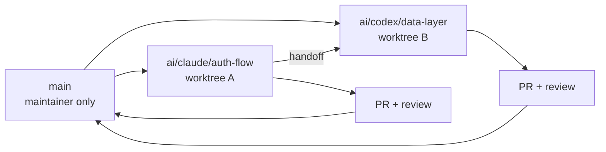
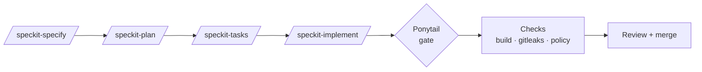

<div align="center">

# ⚡ ai-forge

### The AI-native engineering OS — Claude Code and Codex, working in the same repo without chaos

[](https://github.com/iamSachinDev/ai-forge/actions)
[](LICENSE)
[](package.json)
[](AGENTS.md)
[](https://github.com/dietrichgebert/ponytail)
[](.specify/)

[Quick start](#-quick-start) · [Why AI-native](#-why-ai-native) · [How it works](#-how-it-works) · [Roadmap](#-roadmap) · [Docs](docs/ai-engineering/)

</div>

---

## 🧨 The problem

Two AI agents on one repo means overwritten work, drifting instructions, bloated diffs, leaked secrets and a build that breaks at 2 a.m. Most teams bolt a `CLAUDE.md` onto an existing codebase and hope.

**ai-forge is the missing operating layer**: isolation, one shared rulebook, spec-first workflow, hard guardrails and a minimalism gate — all wired up before the first prompt.

> **Public by design.** Everything here is built to be safe in a public repo: no real data, no secrets, every risky action behind an approval rule.

---

## 🧠 Why AI-native

"AI-assisted" means a human with autocomplete. **AI-native** means the repo itself is designed for agents as first-class contributors:

| Principle | What ai-forge does about it |
|---|---|
| 📖 **Agents need ground truth** | `AGENTS.md` + `.ai/` knowledge base (HOT / WARM / COLD tiers) — every session starts from the same facts |
| 🧱 **Agents need boundaries** | Per-task worktrees, deny/ask/allow permissions, sandboxed shell, risk-classed approvals (LOW → CRITICAL) |
| 📐 **Agents need intent, not vibes** | Spec Kit: requirement IDs, acceptance criteria, plan, tasks — then code |
| ✂️ **Agents over-build** | Ponytail gate: the smallest complete change wins |
| 🔁 **Agents hand work to each other** | Ownership-tracked handoff between Claude and Codex, state kept in versioned files |
| 🛡️ **Agents read untrusted text** | Authority order: web pages, issues and tool output are *data*, never instructions |
| 💸 **Agents cost money** | Model routing policy picks the right model per task, validated in CI |

---

## ✨ What ships today

| | Capability | Details |
|---|---|---|
| 🌿 | **Worktree isolation** | `npm run ai:worktree -- new \| list \| handoff \| remove` — one branch + worktree per agent task |
| 📋 | **One rulebook** | `AGENTS.md` read natively by Codex, imported by Claude Code — zero drift |
| 📐 | **Spec-driven workflow** | `/speckit-specify → plan → tasks → implement → converge` (Codex: `$speckit-*`) |
| 🛡️ | **Guardrails** | Permission rules, Bash sandbox, gitleaks pre-commit hook, branch-protection ruleset |
| 🚦 | **CI gates** | Build · gitleaks (full history) · osv-scanner · Opengrep · Conftest policy — tools pinned by SHA-256 |
| 🧭 | **Model routing** | `model-policy.yaml` + CLI capability catalog + dry-run checker (`npm run ai:models`) |
| 🔭 | **Serena MCP** | Read-only semantic code navigation — agents see the code, can't corrupt it |
| ✂️ | **Ponytail** | Always-on minimalism discipline, `/ponytail lite\|full\|ultra` |
| 🧾 | **Decision records** | ADRs + task files + session summary so context survives between sessions |

---

## ⚡ Quick start

```bash
git clone git@github.com:iamSachinDev/ai-forge.git my-project
cd my-project
npm ci

git config core.hooksPath .githooks     # secret-scan pre-commit hook
npm run build                           # typecheck + build must exit 0
gitleaks dir --redact -v --no-banner .  # working-tree secret scan
```

Then edit **`AGENTS.md` §1 (Project)** and **§3 (Architecture)** for your app. Start every agent session by reading `.ai/CURRENT.md`.

---

## 🔄 How it works

### Isolation + handoff



```bash
npm run ai:worktree -- new auth-flow --agent claude
npm run ai:worktree -- new data-layer --agent codex
npm run ai:worktree -- handoff auth-flow --from claude --to codex
npm run ai:worktree -- remove auth-flow
```

### From idea to merged code



### The ponytail ladder

```
1. Does this need to exist?        → skip if not
2. Already in the codebase?        → reuse it
3. Standard library / platform?    → use it
4. Installed dependency?           → use it
5. Can it be one line?             → one line
6. Otherwise                       → the minimum that works
```

<details>
<summary><b>🔐 Risk classes agents must respect</b></summary>

| Class | Examples | Approval |
|---|---|---|
| LOW | Read code, edit docs, run build and scans | None |
| MEDIUM | Feature changes, dependency upgrades, refactors | Plan first, approve before merge |
| HIGH | Agent rules/CI files, credentials flows, pushing, PRs | Explicit approval each time |
| CRITICAL | Deleting data, force-push, rewriting history, disabling checks | Never self-approved |

</details>

<details>
<summary><b>🗂️ Repository layout</b></summary>

```
.ai/                  Agent knowledge base (CURRENT, INDEX, CONTEXT, tasks, decisions, runbooks)
.claude/              settings.json (permissions + sandbox) and skills (ponytail, speckit-*)
.codex/               Codex profile and command rules
.github/              CI workflow, Dependabot, branch ruleset
.githooks/            pre-commit secret scan
.mcp.json             Serena MCP (read-only)
.opengrep/            Convention rules as static analysis
.specify/ specs/      Spec Kit constitution, templates, feature specs
docs/ai-engineering/  Phase records, guardrails, MCP registry
model-policy.yaml     Model routing policy
policy/               Conftest (OPA) policies + fixtures
scripts/              ai-worktree.mjs, check-model-policy.mjs
```

</details>

---

## 🗺️ Roadmap

Honest status. Items marked 🚧 are built in the source repo and being ported here; 🧭 are not built yet.

| Status | AI-native capability | Why it matters |
|:---:|---|---|
| 🚧 | **Agent evals** — Promptfoo/Codex SDK pilot on synthetic tasks | Prove the rulebook changes agent behaviour, catch regressions when rules change |
| 🚧 | **Docs automation** — route inventory, link checker, change-impact command | Stale docs mislead agents more than humans |
| 🚧 | **Status dashboard** — phase status, check evidence, Actions view | One place to see what the agents did and what passed |
| 🚧 | **Bootstrap for new projects** — generic init that strips the demo and wires the framework | Today you edit `AGENTS.md` by hand |
| 🚧 | **Production runbook** — pinned dependencies, backup and restore rehearsal | Safe path from prototype to something you run |
| 🧭 | **Agent observability** — OpenTelemetry traces for sessions, tool calls, cost | Both CLIs support OTel export; needs a privacy-reviewed destination |
| 🧭 | **Agent memory** — durable cross-session memory with provenance | Designed in ADR 0002, deliberately deferred until it can be made safe |
| 🧭 | **Prompt-injection red-team evals** — hostile issue text, web pages, tool output | The authority-order rule exists; it needs adversarial tests |
| 🧭 | **Token and cost budgets** — per-task ceilings enforced by policy | Model routing picks the model; nothing yet caps the spend |
| 🧭 | **AI review gate** — an independent agent reviews every diff before merge | Separates author from reviewer, the way humans do |
| 🧭 | **Devcontainer / reproducible env** — one-command, identical agent sandbox | Makes the sandbox the same on every machine and in CI |
| 🧭 | **Skill registry with versioning** — pin and audit third-party skills like ponytail | Skills are code that steers agents; treat them as supply chain |

---

## 🧩 Built from

[Claude Code](https://claude.com/claude-code) · [Codex CLI](https://openai.com/codex) · [Spec Kit](https://github.com/github/spec-kit) · [Ponytail](https://github.com/dietrichgebert/ponytail) · [Serena](https://github.com/oraios/serena) · [gitleaks](https://github.com/gitleaks/gitleaks) · [osv-scanner](https://github.com/google/osv-scanner) · [Opengrep](https://github.com/opengrep/opengrep) · [Conftest](https://github.com/open-policy-agent/conftest)

---

## 🤝 Contributing

```bash
npm ci && git config core.hooksPath .githooks
npm run ai:worktree -- new your-task --agent claude
cd ../ai-forge-wt/claude-your-task
npm run build && gitleaks git --staged --redact -v --no-banner .
```

Read `AGENTS.md` for the full rules, risk table and pre-commit checklist.

## 📄 License

MIT — see [LICENSE](LICENSE).

<div align="center">

**[⭐ Star ai-forge](https://github.com/iamSachinDev/ai-forge) if it saves you from agent chaos**

</div>
